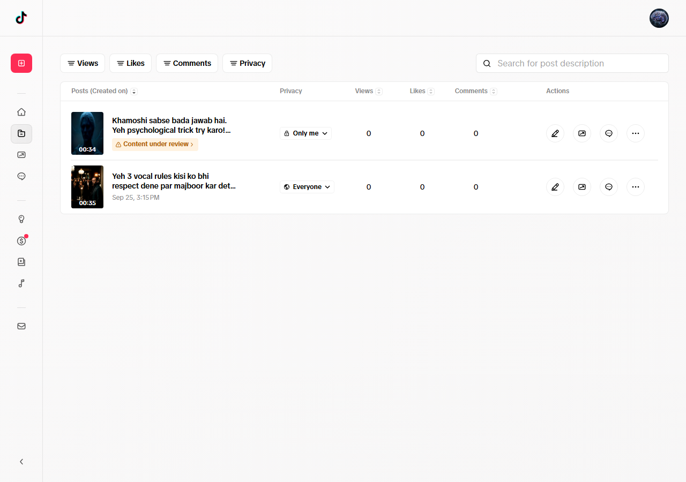

# 🎬 Faceless Video Autopilot - Zero-Touch Viral Media Engine

[](https://github.com/suhailahmed-dev)
[](https://suhailahmed-dev.github.io/portfolio/)
[](https://python.org)
[](https://ffmpeg.org)

An autonomous, end-to-end viral video creation and publishing machine. From AI-driven story scriptwriting and multi-lingual neural speech synthesis to 60FPS kinetic subtitle burning and headless social media publishing.

---

## 📸 Production Verification

<div align="center">
  
  <p><i>Live Production Proof: Automated TikTok Video Publishing via Headless Session Automation</i></p>
</div>

---

## 🌟 Architecture & Automated Workflow

```
┌─────────────────────────────────┐
│     Gemini Viral Story Prompt    │
│  (Psychological Hook Generation)│
└────────────────┬────────────────┘
                 │
                 ▼
┌─────────────────────────────────┐
│   Neural Voice Synthesis (TTS)  │
│    (Urdu, Roman Urdu, English)  │
└────────────────┬────────────────┘
                 │
                 ▼
┌─────────────────────────────────┐
│   FFmpeg Kinetic Subtitle Burn  │
│  (1080x1920 • 60FPS Video Comp) │
└────────────────┬────────────────┘
                 │
                 ▼
┌─────────────────────────────────┐
│   Headless Platform Publisher   │
│   (TikTok • Meta Reels • Shorts)│
└─────────────────────────────────┘
```

1. **Trend Discovery & Scriptwriting:** Analyzes high-retention narrative formats and synthesizes emotional, curiosity-inducing video scripts.
2. **Multi-Lingual Neural TTS:** Native support for high-fidelity speech synthesis in **Urdu**, **Roman Urdu**, and **English** with expressive prosody.
3. **Automated Subtitle Synchronization:** Analyzes word-level timing offsets to burn kinetic, animated karaoke-style subtitles onto background reels.
4. **Autonomous Platform Dispatch:** Headless browser integration with persistent session management for hands-free publishing to TikTok, Instagram Reels, and YouTube Shorts.
5. **Remote Command Hub:** Cloudflare tunnel integration for monitoring queue metrics and publishing approvals from any mobile device.

---

## 🛠️ Tech Stack & Dependencies

- **Language:** Python 3.10+
- **Video Engine:** FFmpeg & MoviePy
- **Audio Synthesis:** Edge-TTS & Custom Master Voice Filter
- **Browser Automation:** Playwright / Selenium
- **AI Core:** Google Gemini API
- **Telemetry:** Streamlit & Cloudflare Tunnels

---

## 👤 Author & Remote Availability

**Suhail Ahmed Buledi**  
- **Email:** [sohailbuledi84@gmail.com](mailto:sohailbuledi84@gmail.com)  
- **WhatsApp:** [+92 309 3174020](https://wa.me/923093174020)  
- **3D Portfolio:** [suhailahmed-dev.github.io/portfolio](https://suhailahmed-dev.github.io/portfolio/)  
- **Availability:** Ready for **Immediate Full-Time Remote Roles (EST / GMT Timezone Overlap)**.
