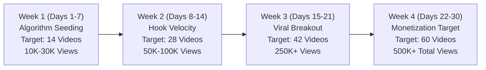

# Fresh Brand Identity & 30-Day 60-Video Viral Growth Target

## 1. Fresh Brand Identity Pack (For New Dedicated Accounts)

Since your current accounts are personal, creating a dedicated brand identity ensures high credibility and algorithmic focus.

### Recommended Brand Names (Pick Your Favorite):

| Option | Brand Name | Handle Suggestion | Vibe / Personality |
| :--- | :--- | :--- | :--- |
| **A (Top Pick)** | **Cognitive Shadow** | `@CognitiveShadow` | Mysterious, elite psychology, deep human secrets |
| **B** | **Alpha Mind Matrix** | `@AlphaMindMatrix` | High-value masculinity, stoicism, confidence hacks |
| **C** | **Dark Axiom** | `@DarkAxiom` | Unspoken human laws, ruthless truths, social dynamics |
| **D** | **Mindset Vault** | `@MindsetVault` | Life hacks, brain productivity, mental mastery |

---

### Bio / Profile Setup Across Platforms:

#### 🟣 Instagram Bio:
```text
🧠 Human Behavior • Dark Psychology • Life Hacks
⚔️ Decode what people never say out loud.
🔥 Daily 1:30 PM & 8:00 PM Drops
👇 Save today's rule before they delete it.
[Link to YouTube Channel]
```

#### ⚫ TikTok Bio:
```text
Unspoken rules of human behavior & psychology 🧠👁️
New secrets daily at 1:30 PM & 8:00 PM ⏳
Follow to master your mind 💯
```

#### 🔴 YouTube Shorts Channel Description:
```text
Welcome to Cognitive Shadow. 

We reveal the hidden psychology of human behavior, high-value communication, and mental models that school never taught you. 

Subscribe for daily 8K cinematic life wisdom & psychological laws. 
No fluff. Just ruthless truth.
```

#### 🔵 Facebook Page Intro:
```text
Daily wisdom on human nature, self-discipline, and character. Helping you navigate life with clarity and strength.
```

---

## 2. The 30-Day 60-Video Viral Roadmap



### 🗓️ Week 1 (Days 1–7): Algorithm Seeding
- **Total Videos:** 14 (2 daily)
- **Focus:** Sharp Body Language & Eye Contact Secrets (Foot angle, Predatory stare, Tactical silence).
- **Goal:** Feed the algorithm consistent watch-time signals. Even if views start at 500-1,000, do not stop! The algorithm tests your consistency.
- **Milestone:** 10,000 – 30,000 total cumulative views.

### 🗓️ Week 2 (Days 8–14): Hook Velocity & Retention Spikes
- **Total Videos:** 28 (Cumulative)
- **Focus:** High-Urgency Life Hacks & Deception Signs (5-Second Brain Rule, Signs of Envy, Dopamine Reset).
- **Goal:** Push Average View Duration (AVD) above 100% using our seamless infinite loop scripts.
- **Milestone:** First 1,000 saves/shares on Instagram & TikTok, 500+ followers.

### 🗓️ Week 3 (Days 15–21): The Viral Breakout Phase
- **Total Videos:** 42 (Cumulative)
- **Focus:** High-Value Character & Stoic Wisdom (How High-Value Men Speak, Law of Reversed Effort, Not Reacting).
- **Goal:** 1 or 2 videos will trigger the algorithm's secondary push (100,000+ views in 48 hours).
- **Milestone:** 1,000 YouTube Subscribers reached.

### 🗓️ Week 4 (Days 22–30): Monetization & Community Lock-in
- **Total Videos:** 60 (Goal Hit!)
- **Focus:** Power Dynamics & Decision Frameworks (24-Hour Rule, Broken Window Discipline).
- **Goal:** Reach monetization thresholds for YouTube Shorts Partner Program & Creator Rewards on TikTok/Facebook.
- **Milestone:** 500,000+ lifetime views, 3,000+ dedicated followers across platforms.

---

## 3. Daily Bot Cadence (Auto-Target Tracking)
The bot's dashboard now tracks this 30-day journey live with:
- **Videos Completed:** `X / 60`
- **Daily Pace:** `2 / Day`
- **Current Streak:** Automatically updates every time a new video is generated!
